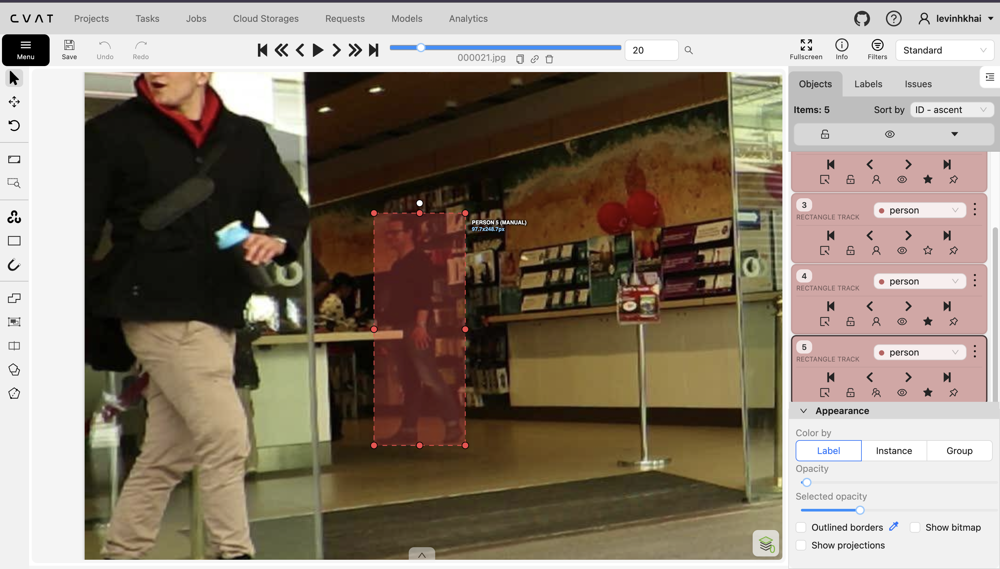
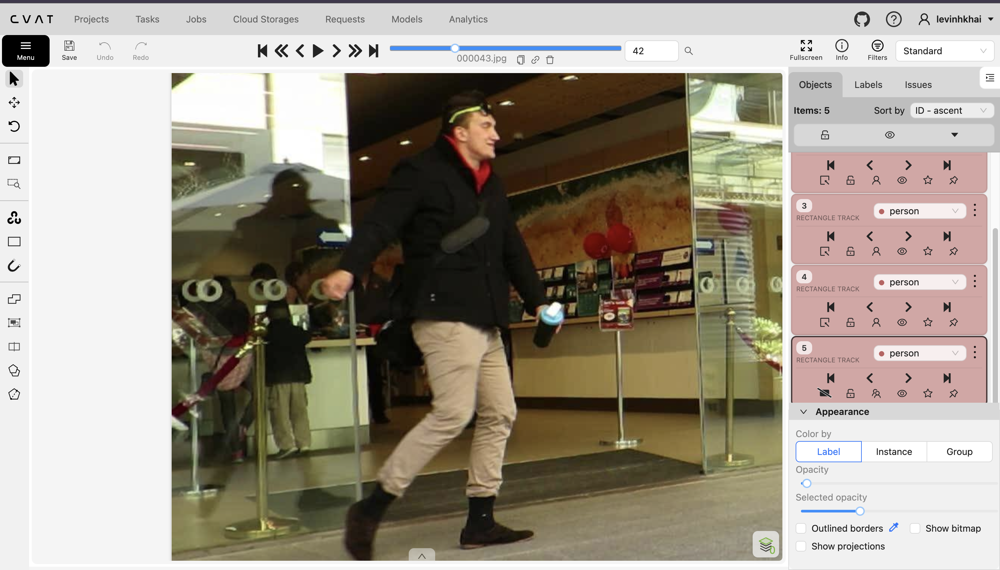
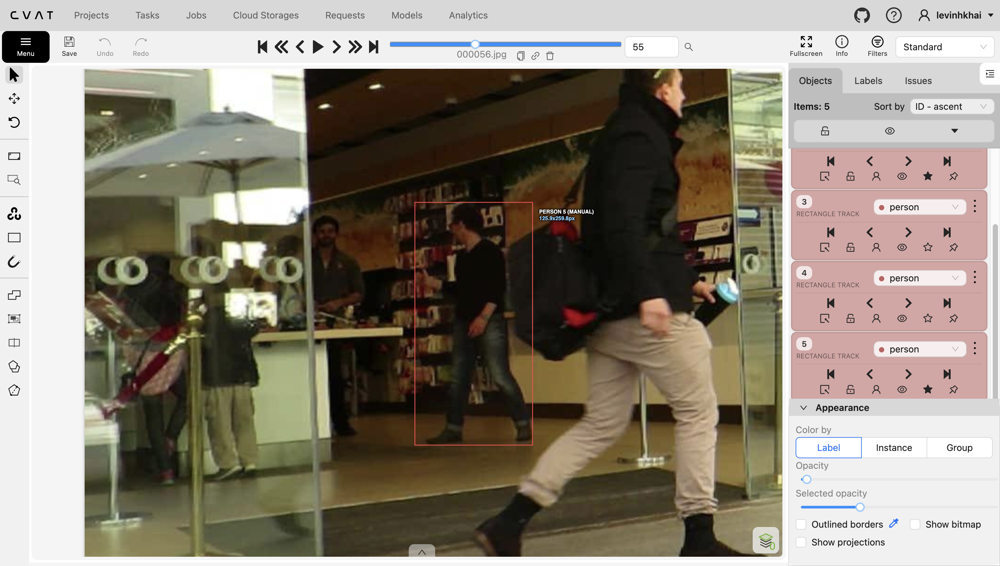

# Báo cáo cá nhân — LeVinhKhai-2A202603322

Đổi tên file theo quy tắc `MSSV_HoTen.md`. Ví dụ: `20241234_NguyenVanAn.md`.

Đoạn video: MOT17-09, 150 frame (frame 1–150), nguồn MOTChallenge, giấy phép CC BY-NC-SA 3.0.

## 0. Thông tin học viên

- Họ tên: Lê Vĩnh Khải
- MSSV: 2A202603322
- Mã đề (A/B/C): Đề B | Task: DAY05-MOT17-09-B-2A202603322
- Email: 26ai.khailv@vinuni.edu.vn
- Link repository: https://github.com/LeVinhKhai/K5-L2B-DAY05-LeVinhKhai-2A202603322-MOTTracking
- Giờ bắt đầu:16h15 13/11/2026
- Giờ kết thúc: 21h 13/11/2026

## 1. Xem trước đoạn video (CP0)

Ghi **trước khi vẽ**, mỗi người một dòng.

| Mã | Frame xuất hiện | Frame cuối thấy được | Rẽ / dừng / đổi tốc độ ở frame | Bị che ở frame | Ghi chú |
|---|---|---|---|---|---|
| P1 - bà áo xanh | 0 | 149 | Chủ yếu đi thẳng, tốc độ ổn định | Không bị che | Đi thẳng đều |
| P2 - ông áo xanh lam | 0 | 149 | Chủ yếu đi thẳng, tốc độ ổn định | Không bị che | Đi thẳng đều |
| P3 - em bé | 0 | 146 | Dừng lại ở frame 27,37 | Bị che ở frame 111-134, 147-149 bị che tiếp bởi 2 ông bà đi bộ  | Bị che khuất khá nhiều |
| P4 - người mẹ | 0 | 127 | Dừng lại 28,36 | Bị che từ frame 106-124,128-149 bị che tiếp bởi 2 ông bà đi bộ | Bị che khuất khá nhiều |
| P5 - người đàn ông trong vodafone | 0 | 149 | Đổi hướng frame 17,37,67 | Bị che từ frame 41-43 | Bị che ít  |

## 2. Keyframe và thời gian (CP1, CP4)

Số keyframe lấy từ kết quả `src/check_submission.py`.

| Mã | Số keyframe | Keyframe ở frame | Số frame có mặt | Keyframe / 100 frame | Thời gian (phút) | Chỗ khó |
|---|---|---|---|---|---|---|
| P1 | 34 | 0, 20, 26, 30, 35, 41, 47, 50, 60, 62, 66, 71, 78, 79, 80, 91, 94, 101, 106, 109, 113, 117, 121, 124, 125, 129, 132, 133, 134, 139, 140, 141, 143, 149 | 150 | 22.7 | 10p | không có |
| P2 | 71 | 0, 1, 2, 3, 4, 5, 6, 10, 16, 17, 20, 22, 24, 25, 27, 30, 31, 32, 34, 35, 37, 38, 40, 43, 44, 48, 50, 54, 55, 60, 62, 63, 64, 65, 67, 68, 70, 80, 82, 84, 86, 88, 89, 90, 91, 92, 93, 94, 97, 99, 100, 102, 103, 110, 114, 115, 116, 119, 120, 122, 124, 125, 126, 127, 129, 130, 135, 136, 139, 140, 149 | 150 | 47.3 | 10p | Không có |
| P3 | 23 | 0, 2, 4, 10, 14, 18, 19, 24, 34, 44, 54, 74, 75, 84, 94, 104, 105, 135, 137, 138, 141, 142, 144 | 123 | 18.7 | 10p | Có khó nhẹ ở đoạn xác frame bắt đầu bị che khuất |
| P4 | 15 | 0, 4, 10, 14, 20, 24, 27, 34, 44, 54, 64, 84, 91, 94, 125 | 109 | 13.8 | 10p | Có khó nhẹ ở đoạn xác frame bắt đầu bị che khuất |
| P5 | 72 | 0, 4, 10, 11, 12, 13, 14, 15, 20, 24, 27, 28, 29, 30, 33, 34, 40, 44, 50, 51, 52, 53, 54, 55, 59, 60, 61, 62, 63, 64, 65, 67, 68, 69, 70, 72, 73, 74, 75, 76, 77, 78, 80, 83, 84, 85, 86, 87, 88, 89, 90, 94, 95, 96, 97, 98, 99, 100, 102, 105, 110, 111, 112, 114, 120, 130, 135, 137, 138, 140, 143, 149 | 147 | 49.0 | 10p | Không có |
| **Tổng** | 215 keyframe |-| 679 frame có mặt | 31.7 keyframe / 100 frame | 50 phút | |

Keyframe / 100 frame của cả bài = tổng keyframe ÷ tổng số frame có mặt × 100 = 31.7 keyframe / 100 frame.

Bạn đặt keyframe nhiều nhất ở người nào? Vì sao (người đó rẽ, dừng, lại gần camera hay bị che)?
Người tôi đặt nhiều keyframe nhất là P5 với 72 keyframe. Lý do là P5 có nhiều đoạn bị che khuất bởi các vật thể xung quanh, và có 1 thời gian ngắn outside nên cần nhiều keyframe hơn quanh các đoạn occlusion/outside, đồng thời có nhiều thay đổi vị trí và kích thước box nên nội suy tuyến tính dễ bị lệch nếu đặt keyframe quá thưa.

...

## 3. Đoạn bị che (CP2)

Người bị che: `P5 -  Người đàn ông trong cửa hàng vodafone`

| Mốc | Frame |
|---|---:|
| Bắt đầu bị che một phần (bật `occluded`) | 0 |
| Mất hẳn (bật `outside`) | 41 |
| Hiện lại (tắt `outside`) | 44 |
| Thấy rõ trở lại (tắt `occluded`) | 55 |

- Thời gian khuất hẳn: 3 frame = 0.1 giây.
- Quyết định: giữ cùng ID 
- Lý do (trả lời 3 câu: khuất bao lâu so với 60 frame, ngoại hình có khớp, chỗ hiện lại có đúng hướng và tốc độ):
Lý do: P5 chỉ bị khuất hoàn toàn trong 3 frame, nhỏ hơn nhiều so với ngưỡng 60 frame (2 giây) của guideline. Khi xuất hiện lại, ngoại hình của người này vẫn khớp với trước khi bị che. Vị trí xuất hiện lại cũng phù hợp với hướng và tốc độ di chuyển trước đó, nên xác định đây vẫn là cùng một người và tiếp tục sử dụng track ID cũ thay vì tạo track mới.

Ảnh chụp màn hình:

 (Do người đàn ông trong vodefone từ đầu luôn có bàn che khuất 1 phần cơ thể nên đã có nhãn occluded, do đó tôi không thể lấy screenshot của người đàn ông đó khi không occluded, nên tôi đã lấy ảnh gần với tình huống trước khi bị che khuất )


“Nguồn ảnh: MOT17, MOTChallenge (Milan et al., 2016).

## 4. Tự review ID (CP3)

Lượt 1 theo người (đi ngược từ frame 149 về 0 trên CVAT), lượt 2 theo cảnh (nhảy 10 frame). Ít nhất 3 dòng; không có lỗi thì ghi một dòng "đã kiểm hai lượt, không lỗi".

Loại lỗi dùng đúng một trong 7 mã: `id_switch`, `fragmentation`, `lost`, `merge`, `false_track`, `drift`, `flag`.

| Frame | Mã người | Loại lỗi | Mô tả một câu | Phát hiện ở lượt | Đã sửa? |
|---:|---|---|---|---|---|
| - | P1–P5 | - | Đã kiểm tra hai lượt, không phát hiện lỗi ID hoặc track còn sót. | Lượt 1 và lượt 2 | Không cần sửa |

Tổng hợp số lỗi theo loại:

| `id_switch` | `fragmentation` | `lost` | `merge` | `false_track` | `drift` | `flag` |
|---:|---:|---:|---:|---:|---:|---:|
| 0 | 0 | 0 | 0 | 0 | 0 | 0 |

Lỗi nào chỉ lượt 2 (theo cảnh) mới thấy, lượt 1 (theo người) không thấy? Vì sao?

Không có

## 5. File xuất và kết quả tự kiểm (CP4)

| Kiểm tra | Kết quả |
|---|---|
| Tên file MOT 1.1 | LeVinhKhai_mot.zip |
| Tên file CVAT for video 1.1 | LeVinhKhai_cvat_video.zip |
| Số track ID khác nhau trong `gt/gt.txt` (phải là 5) | 5 |
| Frame `outside` không có dòng trong `gt.txt` (đúng / sai) | Đúng |
| Job đã completed trên CVAT máy cá nhân | Có |

Dán phần tóm tắt in ra từ `src/check_submission.py`:

```
=== Tóm tắt ===
 Số track ID: 5   |   Tổng số box: 679
  [OK]        Đúng 5 track ID.

  Track | Frame có mặt | Số frame | Đoạn vắng (outside)
      1 |   0–149      |      150 | -
      2 |   0–149      |      150 | -
      3 |   0–146      |      123 | 111–134
      4 |   0–127      |      109 | 106–124
      5 |   0–149      |      147 | 41–43

  [CẢNH BÁO]  Track 2: chiều cao box đổi > 30% trong 1 frame ở frame [3]. Kiểm tra box co giật (co box theo phần nhìn thấy?).
  Lỗi: 0   |   Cảnh báo: 1
  Không có lỗi định dạng. Mở CVAT xem lại từng [CẢNH BÁO]; cảnh báo đúng ý bạn thì ghi lý do vào báo cáo.
  
```
Tôi đã kiểm tra lại trên CVAT tại frame 3. Box vẫn bám đúng đối tượng, do người đó frame 2 chỉ lộ vai, phần còn lại nằm ngoài khung hình. Xong sau đó sang đến frame 3 lộ đầu nên chiều cao box đổi >30% không có điều gì bất thuờng

## 6. Ba câu kết

1. Nếu được gán lại, bạn sẽ đặt keyframe khác ở đâu? Vì sao?

   Nếu được gán lại, tôi sẽ giảm bớt keyframe ở các đoạn người đi thẳng và chuyển động ổn định, đặc biệt ở những track có mật độ keyframe cao. Tôi sẽ tập trung đặt keyframe tại các vị trí đổi hướng, đổi tốc độ, thay đổi kích thước box rõ rệt và trước/sau đoạn bị che khuất. Cách này vẫn giữ được độ chính xác của nội suy nhưng giảm số keyframe không cần thiết.

2. Có chỗ nào bạn không chắc "cùng ID hay ID mới"? Bạn đã quyết định và ghi chú thế nào?

   Không. Trong quá trình gán, tôi không gặp trường hợp nào khiến tôi thực sự không chắc giữa việc giữ cùng ID hay tạo ID mới. Với các đoạn bị che khuất, thời gian khuất đều ngắn hơn ngưỡng 60 frame và đối tượng xuất hiện lại có ngoại hình, vị trí, hướng di chuyển phù hợp, nên tôi giữ nguyên track ID.

3. Một lỗi ID trong job của bạn (nếu không còn sót, chọn lỗi đã sửa) có thể làm xe tự lái dự đoán sai chuyển động của người đó như thế nào? Lỗi đó ảnh hưởng MOTA hay IDF1 nhiều hơn?

   Sau khi review hai lượt, tôi không phát hiện lỗi ID còn sót trong bài. Tuy nhiên, nếu xảy ra lỗi id_switch, hệ thống có thể hiểu một người đang di chuyển là một người khác, khiến quỹ đạo và vận tốc của đối tượng bị thay đổi đột ngột. Trong bài toán xe tự lái, điều này có thể làm hệ thống dự đoán sai hướng hoặc tốc độ di chuyển của người đi bộ và dẫn đến quyết định tránh va chạm không chính xác. Lỗi id_switch ảnh hưởng trực tiếp và rõ hơn đến IDF1, vì IDF1 đánh giá khả năng duy trì đúng danh tính của đối tượng xuyên suốt chuỗi frame; đồng thời nó cũng có thể làm giảm MOTA do MOTA có tính đến ID switch.

## Bonus (nếu làm)

### B1 — Hai người đi sát

...

### B2 — So cách đặt keyframe

| Cách đặt | Số keyframe | Frame trôi nhất | Ghi chú |
|---|---:|---:|---|
| Đều mỗi 30 frame | | | |
| Theo chỗ đổi hướng | | | |

...

### B3 — So với tracker có sẵn

| Frame | Mã người | Tracker làm gì | Nhãn của bạn | Giải thích (đoán rồi sửa / ghép IoU / box score thấp / ngoại hình) |
|---:|---|---|---|---|
| | | | | |
| | | | | |

## 7. Tài liệu tham khảo và công cụ AI đã dùng
docs/GUIDELINE.md, docs/CVAT_CHEATSHEET.md, docs/MOT_FORMAT.md, CHECKPOINTS.md
CVAT Community local (localhost:8080), src/setup_local_lab.py, src/check_submission.py
ChatGPT để giải thích khái niệm/CVAT, giải thích output check_submission.py và rà soát câu chữ
